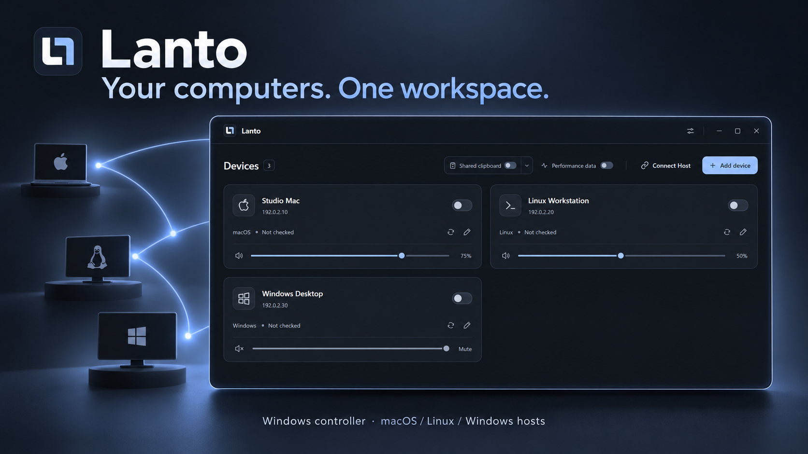
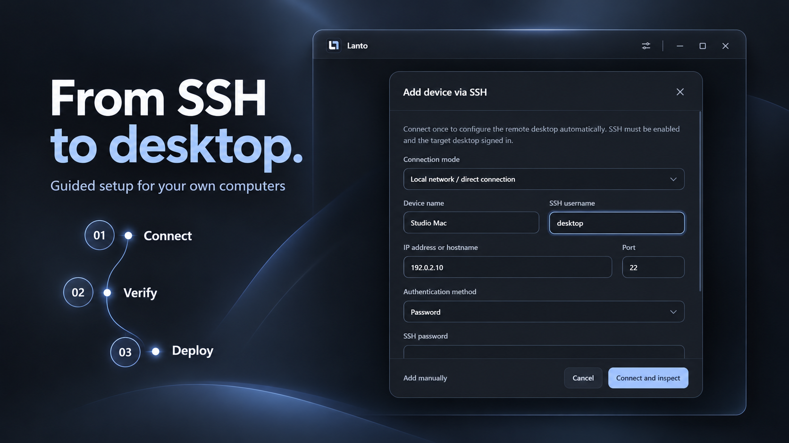
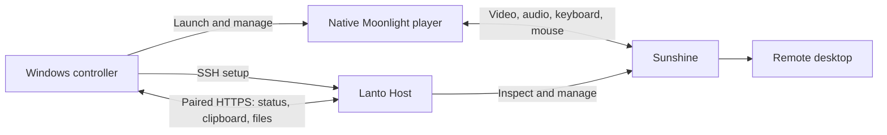
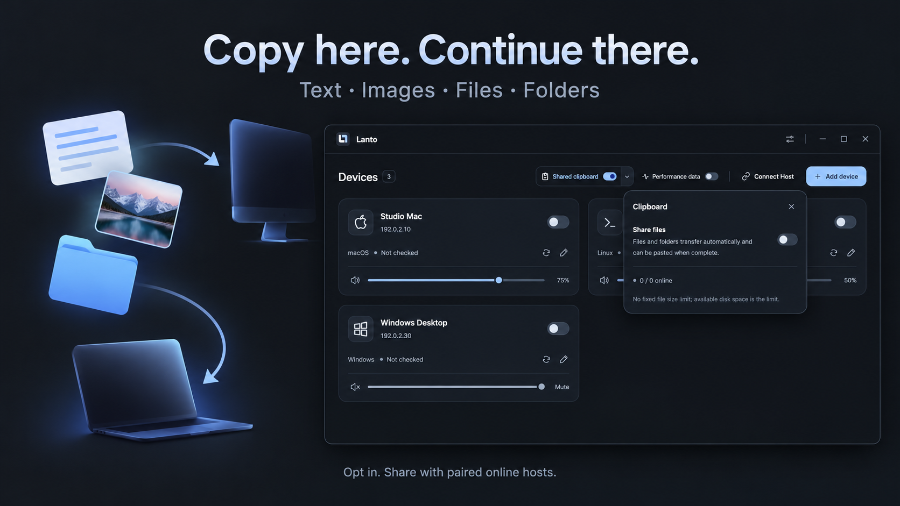
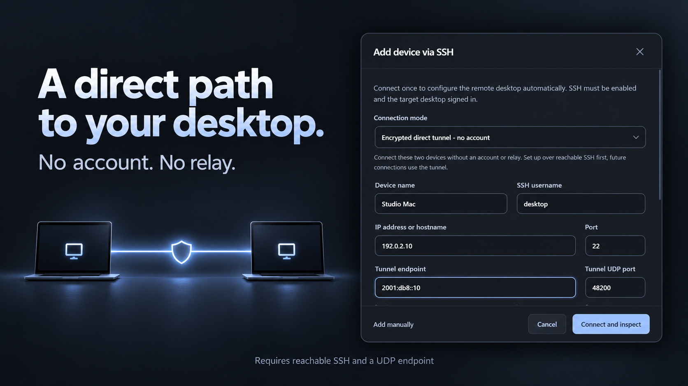

<p align="center"></p>

# Lanto

**Your computers. One workspace.**

Lanto is an open-source remote workspace for people who work across several computers. Keep a Mac, a Linux workstation, and a Windows desktop within reach from a small Windows controller: connect to a desktop, hear its audio, adjust its volume, and share your clipboard and files.

[Download for Windows](https://github.com/omaekumiko3-dev/Lanto/releases/latest) · [Quick start](docs/getting-started.md) · [How it works](docs/architecture.md) · [Contribute](CONTRIBUTING.md)



<p align="center">
  <a href="LICENSE"></a>
  <a href="https://github.com/omaekumiko3-dev/Lanto/releases"></a>
  
</p>

## Why Lanto exists

Different machines are good at different jobs. A Mac may hold your creative tools, Linux your development environment, and Windows your everyday applications. Lanto brings those existing desktops into a consistent workflow without moving your applications or files into a hosted workspace.

The project combines a focused device manager, guided SSH setup, a small Host service, and native streaming through Moonlight and Sunshine. You keep control of the machines and their network. There is no Lanto account, subscription, or hosted relay.

## What you can do

| Capability | What it means in practice |
| --- | --- |
| Manage several computers | Save named devices and connect to one remote desktop at a time. |
| Set up through SSH | Inspect the target, verify its host fingerprint, and install or reuse the required components through the setup wizard. |
| Stream desktop, audio, and input | The native player handles video decoding, sound, keyboard, and mouse outside Electron. |
| Choose stream quality | Select 4K, 1440p, or 1080p and adjust frame rate and bitrate independently. New profiles start at 4K / 30 FPS / 60 Mbps. |
| Control volume per device | Remember volume and mute locally without changing the remote system volume. |
| Share a clipboard | Opt in to plain text and images across paired, online Hosts, even when no desktop stream is open. |
| Move files and folders | Enable file sharing, copy on one computer, wait for the transfer, and paste on another. |
| Switch between local and remote | Press **Ctrl + `** (the key above Tab). The remote window minimizes when you switch away, and the same stream returns on the next press. Change this behavior in Settings; use the device switch to disconnect. |
| Use a direct encrypted tunnel | Optional userspace WireGuard transport with no extra VPN client or account; a reachable UDP endpoint is required. |



## Download and start

1. Download **`Lanto-0.3.1-win-x64.zip`** from [Releases](https://github.com/omaekumiko3-dev/Lanto/releases/latest).
2. Extract the entire folder and run **`Lanto.exe`**. Keep its accompanying files together.
3. Enable SSH on the target computer and sign in to its graphical desktop.
4. Select **Add device**, enter the target address and SSH credentials, and verify the fingerprint. Review the detected setup and select **Deploy**.
5. Grant any required operating-system permissions, then select **Connect device**.

The Windows package includes the native player, Host deployment files, and tunnel helpers. Missing target-side Node.js or Sunshine components are downloaded during setup and checked against pinned SHA-256 hashes. Initial setup needs internet access when those components are absent. You do not need a development toolchain on the controller.

This early release is an unsigned portable application. Verify its checksum against `SHA256SUMS.txt` on the release page. See the [step-by-step guide](docs/getting-started.md) for setup, permissions, updating, and removal.

## Platform status

| Role | Platform | Release status |
| --- | --- | --- |
| Controller | Windows x64 | Packaged and exercised on Windows 11. |
| Remote Host | Windows | SSH deployment, audio, input, clipboard, files, and reconnect tested. |
| Remote Host | macOS | Apple Silicon deployment and streaming tested; screen/audio/input permissions are required. Intel deployment artifacts exist but were not exercised in the release hardware checks. |
| Remote Host | Linux | Ubuntu desktop deployment and streaming tested; clipboard access needs a working graphical session. |
| Controller | macOS / Linux | Source is available; this release does not provide or validate controller packages. |

Desktop sessions up to **2560 × 1440 at 60 fps** were exercised on the tested LAN setups. A subsequent Windows-to-Linux check also received **3840 × 2160 at 30 fps** with a 60 Mbps bitrate setting. Actual quality and latency depend on capture support, encoder/decoder hardware, network conditions, and the display. This is a record of compatibility checks, not a performance guarantee. See [verification notes](docs/verification.md).

## How it works



The Electron controller manages devices, settings, and session lifecycle. The TypeScript Host provides discovery, authorization, status, clipboard, and file transfer. Moonlight and Sunshine carry the desktop stream. A separate Go helper can carry these connections through a direct WireGuard tunnel.

These are separate processes with distinct responsibilities. Ordinary desktop streaming does not render frames inside Electron. [Architecture](docs/architecture.md) describes the trust boundaries and source layout; [native components](native/README.md) documents the patches and pinned upstream sources.

## Clipboard that follows your work

Turn on **Shared clipboard** to synchronize plain text and PNG images with paired, online Hosts. Open its menu and enable **Share files** for files and folders. Transfers complete and are verified before the destination exposes them for pasting. Sharing stays available when you disconnect a desktop stream, while the controller and Hosts remain running.



Sharing is off by default and applies to all paired online Hosts, not only the desktop currently on screen. Clipboard contents can be sensitive; enable sharing for computers you trust. Rich text is transferred as plain text. File transfers are bounded by available storage and protocol validation rather than a fixed file-size ceiling. [Clipboard behavior and limits](docs/clipboard-sync.md).

## Beyond the local network

Choose **Encrypted direct tunnel** during setup to use Lanto's account-free WireGuard transport. The controller uses managed loopback addresses and the target listens on UDP port **48200**. No WireGuard application or driver installation is needed for this userspace path.



A public IPv6 address or a public IPv4 address with UDP forwarding can provide a reachable endpoint. Lanto does not supply a rendezvous server, relay, or universal NAT traversal. Initial provisioning still needs reachable SSH. The tunnel has been tested on a LAN; internet and restrictive-NAT behavior remain unverified for this release. [Direct tunnel guide](docs/direct-tunnel.md).

## Current boundaries

- One active remote desktop stream per controller.
- The target must have a working, signed-in graphical desktop. Pre-login access, wake-on-LAN, headless virtual displays, and all compositor/GPU combinations are not validated.
- Use the remote computer's input method for Chinese and other composed text. Local IME forwarding is not included.
- Local Mac cursor synchronization and the Windows shared-bind graphics path are experimental options. They require compatible native components and are not general performance promises.
- Multi-monitor and mixed-DPI combinations need more testing. Long-running stability and every operating-system upgrade are not established by the current hardware checks.
- There is no built-in automatic updater. Replace the extracted application folder when upgrading; keep your user data if you want to retain pairings.

## Documentation

| Guide | Contents |
| --- | --- |
| [Getting started](docs/getting-started.md) | Download, prerequisites, permissions, first connection, updates, removal |
| [SSH deployment](docs/ssh-deployment.md) | Fingerprint trust, reuse, authentication, and installation behavior |
| [Host service](docs/host.md) | Manual setup and background services |
| [Clipboard and files](docs/clipboard-sync.md) | Formats, transfers, Linux sessions, and troubleshooting |
| [Direct tunnel](docs/direct-tunnel.md) | Endpoints, ports, keys, and limitations |
| [Architecture](docs/architecture.md) | Components, process boundaries, and security design |
| [Build and release](docs/building.md) | Reproduce the controller, Host, native player, and release materials |
| [Verification](docs/verification.md) | Automated checks and the limits of hardware validation |
| [Changelog](CHANGELOG.md) | Changes by published version |

## Build from source

Use Node.js **24.12 or newer** and the Go toolchain specified by [`native/tunnel/go.mod`](native/tunnel/go.mod). Windows packaging also needs PowerShell. Building the native player requires MSVC, a Windows SDK, and Qt; using the released player avoids that native compilation step.

```bash
git clone https://github.com/omaekumiko3-dev/Lanto.git
cd Lanto
npm ci
npm test
npm run build
npm run dev
```

Select a compatible Moonlight executable in Settings when running from source. See [the build guide](docs/building.md) for packaging and the optional macOS clipboard helper.

## Contributing

Reports with the host OS, GPU, network topology, steps to reproduce, and redacted logs are useful. Small fixes, platform testing, accessibility improvements, and documentation corrections are welcome. Read [CONTRIBUTING.md](CONTRIBUTING.md) before opening a pull request and [SECURITY.md](SECURITY.md) before reporting a vulnerability.

## License and acknowledgments

Lanto's original controller, Host, tunnel code, scripts, and documentation are available under the **[MIT License](LICENSE)**. You may use, modify, and redistribute that code, including commercially, subject to the license terms.

The native Moonlight and Sunshine patches and integrations retain their upstream **GPL-3.0** licensing. Bundled third-party libraries retain their own licenses. MIT does not replace those obligations. Release downloads include notices, and the release page provides corresponding native source materials. Read [LICENSES.md](LICENSES.md) and [THIRD_PARTY_NOTICES.md](THIRD_PARTY_NOTICES.md) for the exact scope.

Built on [Moonlight](https://github.com/moonlight-stream/moonlight-qt), [Sunshine](https://github.com/LizardByte/Sunshine), [Electron](https://github.com/electron/electron), [React](https://github.com/facebook/react), [WireGuard Go](https://git.zx2c4.com/wireguard-go/), and [gVisor](https://github.com/google/gvisor). Lanto is an independent project and is not affiliated with or endorsed by these projects.

*The illustrations combine ImageGen artwork with screenshots captured from Lanto itself. Device names and documentation-range addresses are examples. Unedited screenshots and the prompt manifest are in [docs/images](docs/images/README.md).*
