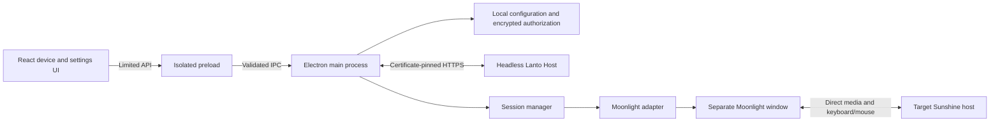

# Lanto Client Architecture

Selected on 2026-10-16. The controller uses Electron + React + TypeScript; Host uses headless Node.js + TypeScript. See [Responsibilities](roles.md) for their contract. Actual Mac, Ubuntu Linux, and Windows hosts have working pairing, authorization, status, and independent media sessions. Each deployment record defines its platform's input-validation scope. Agent orchestration and NAS integration are exploratory ideas outside the released feature set.

## Module boundaries

```text
src/
  common/       Atomic JSON, queues, TCP probes
  protocol/     Host message validation, TLS requests, discovery, pairing tickets
  host/         CLI, configuration, pairing authorization, HTTPS service, lifecycle
  controller/   Host client and trusted-device storage
  shared/       Device/settings/session types, fixed IPC names, main-process input validation
  main/         Electron lifecycle, windows, IPC, shortcuts, workspace orchestration
    config-store.ts      Local configuration reads and writes
    session-manager.ts   Session state and process switching order
    moonlight.ts         Client discovery, arguments, process startup and cleanup
    probe.ts             Sunshine default TCP port probe
  preload/      Limited capabilities exposed through contextBridge
  renderer/     App composition, state hook, connection/device/dialog components and styles
tests/          Core state, persistence, arguments, and process cleanup tests
scripts/        Electron UI smoke tests
```

The renderer only displays state and sends typed requests; it has no Node.js capabilities. The main process verifies the sender window and main frame, validates arguments, and calls configuration and media modules. The native Moonlight process handles the capture protocol, decoding, audio, and keyboard/mouse return channel. Electron does not copy per-frame video through React or IPC.

`Titlebar` owns branding and window buttons. `DeviceCards` uses the top-right switch to connect, disconnect, or switch devices, and provides renaming, settings, and status probing. Settings and pairing remain separate dialogs. Switches reflect session state and turn off when the client exits; the bottom session bar has been removed. Names and configuration can be saved while connected: names display immediately, while connection parameters reach the media process on its next launch. The active device cannot be removed until disconnected. Window control exposes only `minimize`, `maximize`, and `close`, using the same source validation. Electron creates a 900×620 window with `frame: false` and a 680×480 minimum. CSS drag regions exclude buttons, using [Electron custom window interactions](https://www.electronjs.org/docs/latest/tutorial/custom-window-interactions). Advanced settings are collapsible, forms scroll independently, and errors appear inside dialogs without covering their action buttons.



`contextIsolation` and sandboxing are enabled; Node integration is disabled. Pages load only local application resources, and production CSP disallows inline scripts. Navigation, popups, and permission requests are denied by default. External links are limited to two fixed help URLs. Development allows inline scripts/styles for Vite hot reload; production retains strict rules. See [Electron security](https://www.electronjs.org/docs/latest/tutorial/security) and [electron-vite](https://electron-vite.org/guide/).

## Configuration and device identity

Local JSON uses `schemaVersion: 1`. Devices have independent UUIDs and store name, operating system, address, and Sunshine application name; addresses may initially be blank. Optional `hostId` links a paired Host without requiring migration of old configuration. Pairing establishes Host identity; manually editing a device cannot forge this association. User-triggered mDNS discovery reads announcements without treating addresses or discovery results as authorization.

Configuration and session mutations are queued to prevent parallel saves from overwriting each other. Configuration is validated, written to a temporary file in the same directory, and replaced atomically. Corrupt configuration reports its original path and stops startup without overwriting it. `config.json` contains no tokens. `trusted-hosts.json` stores public Host certificates and tokens encrypted through system secure storage. The renderer and activity log do not receive these secrets; activity records remain in memory. Each Host identity file holds its private key and management credential in the user's separate runtime directory.

Paired devices allow editing their nonempty IP address or hostname. Device configuration is the source of the address. Saving synchronizes the trusted Host management address, preserves its port, identity, certificate, and encrypted token, and clears stale probe results. If saving configuration fails, the management address rolls back. Startup repairs address discrepancies from interrupted writes, and in-flight probes of an old address cannot overwrite new status. Streaming uses the device configuration address on the next connection.

## Current session behavior

Media state is `idle → launching → running → stopping → idle`, with errors entering `failed`. `running` only means the operating system successfully started the client process. The upstream CLI does not expose a usable first-frame confirmation interface to this version, so the card says **Client started** without claiming authentication, connectivity, or the requested frame rate. Unexpected exit reasons remain visible as errors.

This version manages one streaming process. Connecting another device waits for the old client to exit before creating the next. Delayed exit events from an old process cannot overwrite the new session. If the old process cannot be stopped, no replacement session starts. Explicit disconnect requests cancel queued connections and wait for a process already being created to become cleanable. Switching local/remote focus preserves the current PID, device, and session start time.

On Windows, Lanto first requests a normal close of its own client window and waits 2.5 seconds, then terminates that child if necessary. Other platforms send SIGTERM before forceful timeout cleanup. Only handles created by Lanto are tracked; unrelated programs are not terminated by process name. The remote Moonlight `quit` command is never used, and `--no-quit-after` is explicit. Timely release of remote keyboard/mouse state after normal or forced exits still requires physical Sunshine/Moonlight verification.

The Moonlight pairing/settings window belongs to the user, not the active streaming process; close it after pairing. Certificates use Moonlight's own storage. This architecture record's initial version has no automatic pairing or isolated certificate directory.

## Shortcuts and return path

The default is Ctrl plus backtick (the key above Tab), registered by Electron's main process. A new shortcut is registered before saving; failure preserves the previous binding, and a failed file write also rolls back the new binding. Remote sessions cannot start without an available binding. Legacy configurations using the old Ctrl+Alt+F12 default migrate once; custom shortcuts remain intact. See [globalShortcut](https://www.electronjs.org/docs/latest/api/global-shortcut).

On Windows, the shortcut toggles the active remote window and the local Lanto window. The new `minimizeOnBlur` preference defaults to true and applies immediately, including Alt+Tab. `src/main/media-window.ts` calls Win32 through the pinned Koffi runtime in the main process, which also receives the shortcut. This preserves Windows' foreground-activation eligibility. Restoration checks actual focus after the asynchronous window operation. See [SetForegroundWindow](https://learn.microsoft.com/en-us/windows/win32/api/winuser/nf-winuser-setforegroundwindow) and [Koffi](https://koffi.dev/).

The window controller holds the original player process handle, checks HWND ownership before each operation, and polls foreground transitions every 50 ms. It only minimizes after the owned player has been foreground; startup, transient null foreground windows, and unrelated applications do not trigger a minimize. Cleanup stops polling and closes the handle without terminating the player. The device switch and application shutdown retain explicit disconnect behavior. `--capture-system-keys never` keeps system combinations local. Game hooks and elevated or exclusive-fullscreen applications require physical validation.

Console rendering does not own input leases. Full ownership transitions, individual key release, human takeover from agents, background audio, and multiprocess prewarming remain media-interface work. Closing a process does not establish that these capabilities exist.

## Probe and verification boundaries

Manual-device TCP probes connect only to port 47989 on the user-specified host, with a fixed two-second deadline. Paired Hosts return identity and local Sunshine port status through certificate-pinned HTTPS. Reachability does not prove streaming. Custom Sunshine ports, Moonlight UUID addressing, and wake-on-LAN are not yet implemented.

Automated checks cover local configuration, IPC, React operations, process state, real loopback TLS, and pairing/revocation without starting actual remote desktops. Smoke tests use separate temporary directories and offscreen Electron; everyday use remains a normal native window. Host has an independent source entry, TypeScript build, runtime packaging, Linux user-service installer, and Windows startup-task installer, with no Electron runtime dependency. Separate physical acceptance records cover Mac, Linux, and Windows.

Linux validation covers the same GNOME Wayland desktop, NVIDIA HEVC 2K60, keyboard/mouse, Chinese Pinyin input, and restart recovery. The local-cursor protocol remains limited to the bundled Mac host and is disabled per platform for Linux/Windows without changing the global preference. Next are GUI agents, NAS, multiple prewarmed sessions, and long runs. Performance targets follow the [design validation table](design.md#performance-records-and-initial-acceptance-targets); short client statistics do not establish end-to-end input latency.
