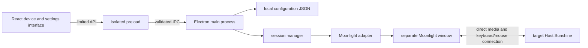

# Lanto Client Architecture

Selection date: 2026-10-16. The client uses Electron + React + TypeScript, and the build uses electron-vite. The current goal is to establish a Windows operations entry point, connect a real desktop on a single Linux1, then expand to multi-machine switching. The Linux1 agent, NAS, and Mac execution hosts continue to follow[Device Responsibilities](design.md)deployment.

## Module Boundaries

```text
src/
  shared/       device, settings, and session types; fixed IPC names; main process input validation
  main/         Electron lifecycle, IPC, global shortcut keys
    config-store.ts      local configuration read/write
    session-manager.ts   session state and process switching order
    moonlight.ts         client discovery, argument construction, process startup and cleanup
    probe.ts             default Sunshine TCP port probe
  preload/      limited capabilities exposed through contextBridge
  renderer/     React interface and styles
tests/          core state, persistence, arguments, and process cleanup tests
scripts/        Electron UI smoke tests
```

The renderer only displays state and issues typed requests; it has no Node.js capabilities. The main process verifies the sending window and main frame, validates parameters, then calls the configuration and media modules. The native Moonlight process handles protocol capture, decoding, audio, and keyboard/mouse return input; Electron does not copy per-frame video data through React or IPC.



`contextIsolation`, sandbox enabled, Node integration disabled. The page only loads local application resources, and the production CSP disallows inline scripts; navigation, popups, and permission requests are denied by default. External links only support two fixed help addresses. Development mode allows inline scripts/styles for Vite hot reload; production builds still use strict rules.[Electron Security Guidelines](https://www.electronjs.org/docs/latest/tutorial/security)、[electron-vite](https://electron-vite.org/guide/)。

## Configuration and Device Identity

Local JSON includes `schemaVersion: 1`. Each device uses a separate UUID; its address may be left blank temporarily. The saved fields are name, operating system, host address, and Sunshine application name. Automatic scanning is not included; the host address also does not replace Moonlight’s certificate and pairing mechanism.

Configuration and session changes are queued for execution to prevent concurrent saves from overwriting each other. Configuration is validated first, then written to a temporary file in the same directory and replaced; corrupted configuration displays the original path and stops startup without overwriting the original file. Credentials, pairing certificates, PINs, and SSH keys are not written to configuration or activity logs. Activity records exist only in memory.

## Current Session Behavior

The media state is `idle → launching → running → stopping → idle`, errors go to `failed`。`running` This only indicates that the operating system successfully started the client process. The upstream CLI does not yet provide a usable first frame confirmation interface for this version, so the UI shows Client Started and does not claim authentication, connection, or 30fps.

This version manages only one streaming process. When connecting to another device, it waits for the old client to exit before creating a new process. A delayed exit notification from the old process cannot overwrite the new session; if the old process cannot be terminated, starting a replacement session is blocked. A return request cancels any connection not yet executed and waits for a process being created to reach a state where it can be cleaned up.

On Windows, first send a normal close-window request to the process created by Lanto and wait 2.5 seconds; if it has not exited, terminate that child process. On other platforms, send SIGTERM first, then force exit after a timeout. Only handles created by this application are tracked; other programs are not closed in bulk by process name. Moonlight’s remote `quit` command is not executed, and `--no-quit-after`is set explicitly. Whether remote keyboard and mouse state is released promptly during normal disconnect and forced exit must still be verified on real Sunshine/Moonlight machines.

The window for opening Moonlight pairing settings is controlled by the user and is not part of the active streaming process; close it after pairing. Certificates use Moonlight’s own storage. This version has no automatic pairing or separate certificate directory isolation.

## Shortcuts and Return Path

Default `Control+Alt+F12`, registered by the Electron main process and still responsive after the renderer loses focus. When saving a new shortcut, registration is attempted first; if it fails, the old binding is retained. If saving the file also fails, the new binding is undone. Starting a remote session is blocked when no binding is available.[globalShortcut documentation](https://www.electronjs.org/docs/latest/api/global-shortcut)。

The return operation attempts to end the streaming client and show the local Lanto window. It does not automatically activate the game or hide the client to keep the connection alive. To verify the return path first, the default passes `--capture-system-keys never`. System shortcuts such as the Windows key remain local for now. Whether the shortcut is affected by a game, system permissions, or third-party hooks needs on-site verification.

Console redraw does not provide an input lease. Full ownership switching, per-key release, manual takeover from the agent, background audio, and multi-process prewarming are still work for future media interfaces; closing a process does not mean these capabilities have been implemented.

## Probe and Verification Boundaries

The TCP probe connects only to port 47989 on the host specified by the user, with a fixed two-second timeout. It does not read web pages or collect authentication information. A response from the port only indicates reachability; it does not prove the other party is a trusted Sunshine instance. Custom server ports, UUID addresses, automatic discovery, and Wake-on-LAN have not yet been added.

Automated checks cover local configuration, IPC, React operations, and process state; they do not start a real remote desktop. Smoke tests use an independent temporary directory and offscreen Electron rendering; everyday operation still uses a normal native window. Platforms other than Windows have not been tested on site.

The next stage requires the user to provide Linux1’s address and desktop environment, along with the Windows/Linux GPU information. First verify pairing, 2K 30fps, Chinese input, return to this machine, and continued agent task operation; then decide on multi machine warm up and the embedded media approach. The performance target follows[the validation table in the design document](design.md#Performance-Records-and-Initial-Acceptance-Targets), with no real machine benchmark results yet.
