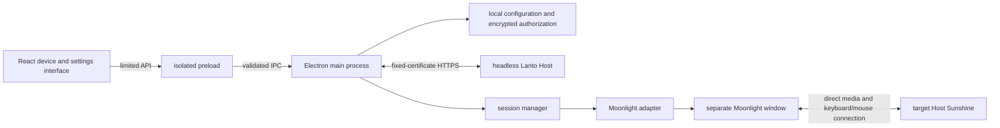

# Lanto Client Architecture

Selection date: 2026-10-16. The controller uses Electron + React + TypeScript, and the Host uses headless Node.js + TypeScript. See the responsibility contract in[Responsibilities of the Two Sides](roles.md). Pairing, authorization, status, and independent media sessions are working with real Mac and Ubuntu Linux hosts. Linux1’s agent and the NAS still follow[Device Responsibilities](design.md).

## Module Boundaries

```text
src/
  common/       atomic JSON, queue, TCP probe
  protocol/     Host message validation, TLS requests, discovery, and pairing credentials
  host/         CLI, configuration, pairing authorization, HTTPS service, and lifecycle
  controller/   Host client, trusted device storage
  shared/       device, settings, and session types; fixed IPC names; main process input validation
  main/         Electron lifecycle, windows, IPC, shortcuts, and workbench orchestration
    config-store.ts      local configuration read/write
    session-manager.ts   session state and process switching order
    moonlight.ts         client discovery, argument construction, process startup and cleanup
    probe.ts             default Sunshine TCP port probe
  preload/      limited capabilities exposed through contextBridge
  renderer/     App composition, state hooks, connection/device/dialog components and styles
tests/          core state, persistence, arguments, and process cleanup tests
scripts/        Electron UI smoke tests
```

The renderer only displays state and issues typed requests; it has no Node.js capabilities. The main process verifies the sending window and main frame, validates parameters, then calls the configuration and media modules. The native Moonlight process handles protocol capture, decoding, audio, and keyboard/mouse return input; Electron does not copy per-frame video data through React or IPC.

Window and simple interface responsibilities:`Titlebar` handles brand display and window buttons,`DeviceCards` uses the upper-right switch for connect/disconnect/switch operations and provides rename, settings, and status checks; settings and pairing remain separate dialogs. The switch reflects session state and closes automatically when the client exits; the bottom session bar is removed. Names and configuration can be saved during a connection. The name appears immediately, while connection parameters are passed to the media process on the next start. The current device cannot be removed before disconnecting. Window controls expose only `minimize`、`maximize`、`close` three actions and use the same origin validation. Electron creates a `frame: false` 900×620 window, minimum 680×480; CSS drag regions exclude buttons. It uses the drag-region mechanism from [Electron Custom Window Interactions](https://www.electronjs.org/docs/latest/tutorial/custom-window-interactions) . Advanced settings are collapsed, forms scroll independently, and errors appear inside dialogs to avoid covering action buttons.



`contextIsolation`, sandbox enabled, Node integration disabled. The page only loads local application resources, and the production CSP disallows inline scripts; navigation, popups, and permission requests are denied by default. External links only support two fixed help addresses. Development mode allows inline scripts/styles for Vite hot reload; production builds still use strict rules.[Electron Security Guidelines](https://www.electronjs.org/docs/latest/tutorial/security)、[electron-vite](https://electron-vite.org/guide/)。

## Configuration and Device Identity

Local JSON includes `schemaVersion: 1`. Devices use separate UUIDs. The address can be temporarily left blank. The name, operating system, host address, and Sunshine application name are saved. Optional `hostId` associates a paired Host; old configuration requires no migration. Host identity is established through pairing, and editing a manual device cannot forge an association. LAN discovery is user-initiated and reads announcements through mDNS; neither a host address nor a discovery result is treated as authorization.

Configuration and session changes are queued to prevent concurrent saves from overwriting each other. Configuration is validated first, written to a temporary file in the same directory, then replaced. A corrupted configuration displays its original path and prevents startup; the original file is not overwritten.`config.json` does not store tokens;`trusted-hosts.json` stores the Host public certificate and a token encrypted by system secure storage. The renderer and activity logs do not receive these secrets; activity records exist only in memory. The Host’s local identity file holds its own private key and management credentials and is stored separately in the user runtime directory.

Paired devices allow IP/hostname editing, and the address must be non-empty. Device configuration is the source of the address; when saved, it synchronizes the management address of the trusted Host while preserving the port, identity, certificate, and encrypted token, and clears old detection status. If writing configuration fails, the management address is rolled back. At startup, an address mismatch caused by an interrupted write is repaired. An in-flight check for the old address cannot overwrite the new address status. Streaming uses the address in the device configuration; new settings take effect on the next connection.

## Current Session Behavior

The media state is `idle → launching → running → stopping → idle`, errors go to `failed`。`running` . This only indicates that the operating system successfully started the client process. The upstream CLI does not yet provide a first-frame confirmation interface usable by this version, so the device card says Client Started and does not claim authentication, connectivity, or that the configured frame rate has been reached. The cause of an abnormal exit is still shown as a necessary error message.

This version manages only one streaming process. When connecting to another device, it waits for the old client to exit before creating a new process. A delayed exit notification from the old process cannot overwrite the new session; if the old process cannot be terminated, starting a replacement session is blocked. A return request cancels any connection not yet executed and waits for a process being created to reach a state where it can be cleaned up.

On Windows, first send a normal close-window request to the process created by Lanto and wait 2.5 seconds; if it has not exited, terminate that child process. On other platforms, send SIGTERM first, then force exit after a timeout. Only handles created by this application are tracked; other programs are not closed in bulk by process name. Moonlight’s remote `quit` command is not executed, and `--no-quit-after`is set explicitly. Whether remote keyboard and mouse state is released promptly during normal disconnect and forced exit must still be verified on real Sunshine/Moonlight machines.

The window for opening Moonlight pairing settings is controlled by the user and is not part of the active streaming process; close it after pairing. Certificates use Moonlight’s own storage. This version has no automatic pairing or separate certificate directory isolation.

## Shortcuts and Return Path

Default `Control+Alt+F12`, registered by the Electron main process and still responsive after the renderer loses focus. When saving a new shortcut, registration is attempted first; if it fails, the old binding is retained. If saving the file also fails, the new binding is undone. Starting a remote session is blocked when no binding is available.[globalShortcut documentation](https://www.electronjs.org/docs/latest/api/global-shortcut)。

The return operation attempts to end the streaming client and show the local Lanto window. It does not automatically activate the game or hide the client to keep the connection alive. To verify the return path first, the default passes `--capture-system-keys never`. System shortcuts such as the Windows key remain local for now. Whether the shortcut is affected by a game, system permissions, or third-party hooks needs on-site verification.

Console redraw does not provide an input lease. Full ownership switching, per-key release, manual takeover from the agent, background audio, and multi-process prewarming are still work for future media interfaces; closing a process does not mean these capabilities have been implemented.

## Probe and Verification Boundaries

The TCP probe for a manual device only connects to port 47989 on the user-specified host, with a fixed two-second timeout. A paired Host uses certificate-pinned HTTPS to return its identity and local Sunshine port status. Reachable status does not prove streaming has completed. Custom Sunshine ports, Moonlight UUID addresses, and remote wake-up have not yet been added.

Automated checks cover local configuration, IPC, React operations, process status, real loopback TLS, and pairing/revocation; they do not start a real remote desktop. Smoke tests use a separate temporary directory and offscreen Electron rendering; normal operation still uses a standard native window. The Host has a separate source entry point, TypeScript build, runtime directory packaging, and Linux user service installation script, and does not depend on Electron at runtime. See each platform’s deployment record for separate on site acceptance on Mac and Linux.

Linux has been verified with the same GNOME Wayland desktop, NVIDIA HEVC 2K60, keyboard and mouse, Chinese Pinyin, and recovery after restart; the local cursor protocol remains limited to the paired Mac. When connecting to Linux/Windows, that protocol is disabled according to the host platform without rewriting the global preference. The next phase will validate GUI agents, NAS, multi-machine warm-up, and long-running operation. Performance targets follow[the validation table in the design document](design.md#Performance-Records-and-Initial-Acceptance-Targets); short-term client statistics cannot be treated as an end-to-end input latency conclusion.
