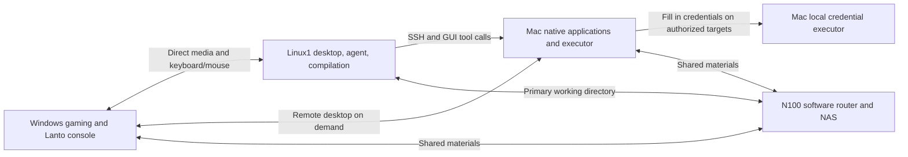

# Lanto Product and Technical Design

Design date: 2026-10-16. Status: preliminary proposal awaiting device validation.

Lanto brings Windows local gaming, Linux1 everyday development, and Mac native application use into one keyboard and mouse entry point. The user views the remote desktop on Windows, an agent stays resident on Linux1, and the N100 handles only routing and storage. Media transport and tool execution are managed separately so background development tasks continue while switching interfaces.

## Device Responsibilities

| Device | Work handled | Local state to retain |
| --- | --- | --- |
| Primary Windows machine | Gaming, Lanto console, remote desktop decoding, keyboard and mouse entry point | Windows, games, client configuration, and a small amount of cache |
| Linux1 self-built host | Linux desktop, agent, computer use, IDE, browser, compilation and tests, optional Windows VM | System, applications, build cache, container images, browser and agent runtime state |
| Mac | macOS native applications, Xcode, signing, GUI tool execution | macOS, toolchains, GUI Bridge, signing materials, and runtime cache |
| N100 | Software router, DHCP/DNS, NAS primary working directory and shared files | Router configuration, storage services, persistent project files |
| Remaining self-built hosts | Future remote targets, testing, or backup | Unassigned; do not reinstall in advance |

The N100 is known to have 8GB of memory and 6 2.5G Ethernet ports. NAS disk interfaces, drive bays, power supply, and cooling, as well as the network cards and GPUs in the other machines, have not yet been inventoried. This design does not assume that large builds, desktop coding, or agent inference will run on the N100.

## User Flow

1. The user plays a local game on Windows; the Linux1 agent is already performing a task in an ongoing session.
2. The user triggers the device switching shortcut. Lanto displays the existing Linux1 desktop and transfers input ownership to that session.
3. The user reviews the agent’s results, modifies the project, runs tests, and previews it in a browser. Files are saved directly in the NAS primary working directory.
4. When the agent needs the Mac, it runs commands over SSH or invokes local GUI tools on the Mac; if needed, it requests configured credentials to be filled in.
5. The user switches back to Windows. All remote key and mouse capture is released, and the Linux1 task continues running.

The first release uses the full desktop as its primary entry point. VS Code Remote SSH can serve as a low-bandwidth auxiliary entry point, but does not replace the Linux1 desktop and computer use workflow the user has chosen.

## Connection Structure

Arrows indicate logical communication and do not mean media is transcoded through the N100. When devices are on the same LAN, the display is sent directly from the target host to Windows. The N100 provides routing and address services; the forwarding path within the same switched network depends on the actual cabling. Software bridging across multiple independent network ports also uses N100 resources, so six ports cannot be treated as a zero-cost hardware switch.

## Client and Media Adapter

First evaluate Tauri with Rust for the console and TypeScript for the interface. Electron is the alternative; existing orchard-relay also uses Electron. The media adapter manages an independent process, reusing Moonlight Qt first, with RDP or other protocols added later based on measurements.

The first release’s media view uses a separate native window; the console handles activation, display mode, and returning to the local machine. WebView does not decode native Moonlight video. Forcing an external window to embed may cause DPI, focus, rendering, and lifecycle issues, so this requires a separate experiment before a decision.

Each adapter provides a unified capability description and lifecycle operations:

| Action | Meaning |
| --- | --- |
| `probe` | Read host reachability, protocol version, capture/encoding, and input capabilities |
| `pair` | Establish device trust and save a certificate or host identity reference |
| `connect` | Create a media process with an independent session ID |
| `activate` | Show the target window and acquire input ownership |
| `deactivate` | Release captured keys, mouse buttons, and gamepad; turn off inactive audio |
| `disconnect` | End the media session without ending the remote agent or desktop task by default |
| `health` | Report connection, decoding, dropped frames, focus, and error status |

Moonlight already has CLI options for resolution, fps, bitrate, window mode, absolute mouse, system keys, and other settings, but this does not prove that dynamic frame rate reduction has no cost or that all state can be safely shared across processes.[CLI source code](https://github.com/moonlight-stream/moonlight-qt/blob/b0af84ead19e711a55db46f8900182d2e0fa3716/app/cli/commandlineparser.cpp)。

## Session and Input Handoff

The device connection state is `offline → discovered → pairing → ready → connecting → streaming`, with an error state transitioning to `reconnecting` or `failed`. Connection state and input ownership are represented separately: a session can remain connected without having any input rights.

The switching order is fixed:

1. Stop sending new input to the old target and release keys and mouse buttons held down remotely.
2. Revoke the old session’s input lease and deactivate its gamepad and inactive audio forwarding.
3. Activate the new target window and confirm focus; if this fails, return to the local Windows machine.
4. Grant input rights to the new session. Discard queued events with the old session ID.

Keep an emergency return shortcut handled by the Windows console; the remote host must not consume it. The device-switching key combination can be configured to handle conflicts with games, input methods, and system shortcuts. Windowed or borderless games are the first test mode; exiting exclusive fullscreen, display modes, and pause behavior will be tested separately. Instant exit is not promised for every game.

When streaming already sends keyboard and mouse input back, Deskflow/Lan Mouse is not injected again along the same path. A future custom input backend will still use the same lease management.

When the agent and a person operate the same remote desktop, human control takes priority: pause GUI automation scheduling for that device and resume it after the user releases control. Ordinary CLI builds can continue. This mechanism manages input and tool calls connected through Lanto; it cannot automatically constrain external remote control programs that are not integrated.

## Linux1 Desktop and Persistent Tasks

The desktop the user sees must be in the same graphical session as the agent’s browser and GUI tools. Connecting to a different xrdp, container, or headless desktop does not mean it is the same desktop just because the host name matches.

First record the Linux distribution, desktop environment, X11/Wayland, GPU, and driver. Choose the Sunshine capture method and input permissions based on this inventory. Selkies is only a conditional browser route: an existing X.Org session can be evaluated for comparison, while a dedicated Wayland session requires all GUI work to move into it; do not assume it can capture an existing Wayland session.[Selkies native deployment](https://docs.selkies.io/latest/native/)。

Terminal agents can run in tmux or an equivalent service. Hiding the media window, disconnecting, or exiting the client should not actively terminate the agent. Host restarts and process crashes are separate recovery problems; keeping a remote desktop resident does not mean tasks recover across restarts.[tmux documentation](https://github.com/tmux/tmux/wiki/Getting-Started)。

## NAS Primary Working Directory

Place the source primary working directory on the N100 NAS, then mount it on Linux1 for use, for example `/mnt/nas/projects/app`. Compilation and testing processes still run on Linux1, and file access goes over the LAN. This provides a unified working directory without manual syncing; it does not provide the access latency of a local SSD.

| Data | Default location | Reason |
| --- | --- | --- |
| Source code, Git metadata, documents, assets | NAS | One persistent primary working directory |
| Release artifacts, archived task logs | NAS | Available to multiple devices and backed up |
| Dependencies, virtual environments, Rust target, Godot import cache, temporary outputs | Linux1 local cache, configured per project | Reduce small network file operations; caches can be rebuilt |
| Docker image layers, browser profile, agent session database | Linux1 local persistent runtime directory | Must satisfy storage driver and database locking semantics; cannot be treated wholesale as temporary files to delete |
| Windows VM images and Windows-specific build cache | Prefer the Linux1 local SSD | Avoid adding virtual machine random writes to the NAS primary working directory |
| SSH, signing, and password vault | The corresponding credential manager or machine-local secure storage | The NAS and source repository store credential references only |

When source code is mounted into a development container over the network, you can mount `node_modules` and other directories as local volumes on Linux1. Different operating systems and build targets use separate dependencies and caches; Windows and Linux must not write to the same installation directory.

For Windows and Mac access to shared files, prefer SMB. Linux1 can initially use SMB as well; evaluate NFS when project dependencies require POSIX permissions or symbolic links. Do not casually mix multiple protocols or write endpoints for the same working directory. Keep routine Git and build operations on Linux1, and create a separate worktree for each agent task. Before starting a task, check the NAS mount and target directory identity to avoid writing to a same-named empty local directory if the mount has failed.

Node file watching may be unreliable over NFS/SMB, so configure polling in the relevant tools for hot reload. Do not assume that network file locking for SQLite and other file databases behaves like local file locking.[Node file watching](https://nodejs.org/download/release/latest-jod/docs/api/fs.html)、[SQLite network file notes](https://www.sqlite.org/useovernet.html)、[Docker storage requirements](https://docs.docker.com/engine/storage/drivers/select-storage-driver/)。

## Mac Execution Endpoint and Credentials

Prefer SSH for commands and builds. Run native applications through the local Peekaboo Bridge on the Mac or a verified executor. Linux1 calls it through an authenticated tool bridge; the model does not need to be copied to the Mac. The tool returns the target application, window, or interface snapshot identifier and the operation result, so subsequent clicks and text input are bound to the same target.

Initial Mac setup requires Remote Login, a graphical session, and Screen Recording and Accessibility permissions. When called over SSH, capture must be routed to the correct GUI Bridge; checking only the CLI process permissions is not sufficient.[Apple Remote Login](https://support.apple.com/en-au/guide/mac-help/mchlp1066/mac)、[Peekaboo Bridge and permissions](https://peekaboo.sh/quickstart.html)。

KRU uses the existing credential tool contract. Verify SSH/HTTP credential use on Linux separately from filling input fields on the Mac. Each fill operation is bound to a device, application or website, window, field, and one-time request identifier; filling fields on the Linux foreground desktop must not be treated as local Mac field entry. Client configuration and logs do not store password contents. Retain separate handling paths for Touch ID, MFA, signing keychains, and startup unlock according to the specific workflow.

Existing [orchard-relay](https://github.com/omaekumiko2-create/orchard-relay) It provides source snapshots, SSH workers, reconnectable builds, logs, and cancellation flows, which can serve as a reference for a build adapter. It was not modified in this round, and the source snapshot mechanism is not imposed on routine NAS code editing.

## Windows Builds

Linux1 is the development entry point. Prefer running JS/TS builds, suitable Rust Windows GNU targets, routine Godot Windows exports, and Electron packaging directly when feasible. Use a Windows VM on Linux1 for Python PyInstaller Windows packages, MSVC, and native Node dependencies that compile locally.

The agent prepares a separate build snapshot or working directory for the Windows VM and automatically collects the artifacts back to the NAS. The snapshot can include saved but uncommitted changes; do not let different toolchains write to dependencies and caches in the main working directory. This process still has data transfer costs, but the user does not need to maintain a second everyday repository manually.

Final graphics, drivers, keyboard and mouse capture, and game performance still need acceptance testing on real Windows hardware. A VM build does not mean behavior will be exactly the same on real hardware.[Rust Windows targets](https://doc.rust-lang.org/rustc/platform-support/windows-gnu.html)、[Electron cross-platform builds](https://www.electron.build/v26/docs/features/multi-platform-build/)、[PyInstaller](https://pyinstaller.org/en/stable/)、[Godot Windows exports](https://docs.godotengine.org/en/stable/tutorials/export/exporting_for_windows.html)。

## Network and Device Identity

Devices are on the same local network. N100 uses DHCP address reservations to manage common devices, and the software also saves device identity and certificate fingerprints; a stable IP makes locating a device easier but cannot replace authentication. Discovery uses mDNS/DNS with manual address fallback.

Media is transmitted directly between Windows and the target host, and is not routed through the NAS, cloud, or a proxy by default. To achieve 2.5G shared drive throughput, the client network adapter, switching equipment, and NAS interface along the link must also support it. Test bandwidth contention when shared drive transfers and desktop streaming run at the same time; do not equate local network speed directly with internet plan speed.

## Validation Phases

### Phase Zero: Single Linux1 Link

- Inventory the Windows graphics card and monitor, Linux GPU and desktop environment, and actual wired link.
- Select a stable Sunshine version that can be rolled back and a Moonlight client; record versions, configuration, and file checksums.
- Validate code reading, scrolling, dragging, terminal use, Chinese input, and audio at 2560×1440, 30fps.
- Verify that the user view and agent use the same graphical session, and that agent tasks continue running after switching back to the game and disconnecting.
- Repeatedly return to the local machine and check that Ctrl/Alt/Shift, mouse buttons, and game controllers are not left captured.

### Phase One: Two Hosts and Hot Switching

- Evaluate one worker process per host, connected to both Linux1 and Mac.
- Check whether configuration files and certificate stores overwrite one another; validate focus switching, DPI, input release, and client exit.
- Compare CPU, GPU, video memory, bandwidth, and game frame times with one active stream versus one active stream plus one prewarmed stream.
- Keep the native window management approach initially, then decide whether to modify Moonlight or introduce a shared rendering surface.

### Phase Two: Mac Arm

- Complete SSH commands, GUI screenshots, accessibility targeting, clicks, and ordinary text input.
- Have the Mac credential executor fill in a test account and verify that secrets do not appear in return values or ordinary logs.
- Verify that manual takeover pauses the GUI agent and that it does not execute stale coordinate or field operations after resuming.
- Independently verify screen lock, restart, lost permissions, and authentication flows that require user involvement.

### Phase Three: NAS Development and Builds

- Use actual Rust, Electron/JS/TS, Python, and Godot projects to test Git, dependency installation, builds, and hot reload.
- Compare configurations with dependencies on the NAS and in the local cache, while keeping the constraint that source code always remains on the NAS.
- Check disconnections, remounts, multiple worktrees, and collection of Windows VM build artifacts.
- Integrate the complete device inventory and task status before considering a browser fallback view, RDP, and other devices.

## Performance Records and Initial Acceptance Targets

Only 2K 30fps is a display requirement specified by the user. The following time thresholds are candidate engineering targets for Phase Zero testing, not measured results or hardware commitments. If the baseline does not meet them, first locate the bottleneck, then adjust the targets or implementation.

| Metric | Candidate target or recording method |
| --- | --- |
| Resolution and frame rate | 2560×1440, 30fps; on a static desktop, the encoder may output frames as needed |
| Continuous operation on an active desktop | Record rendered frame rate, dropped frames, and stutter during a scrolling test; run continuously for at least 30 minutes |
| Switching between connected sessions | From a key event until the new view is usable; initial target P95 no greater than 500ms, at least 100 times |
| Input-to-screen response | Initial target P95 no greater than 120ms; measure externally or end to end with synchronized timing; do not use ping as this metric |
| Cold connection and recovery after disconnection | Record first-frame, reauthentication, and input recovery times separately; do not combine them with hot-switching data |
| Bitrate | 10/20/35 Mbps as experimental settings; choose based on content, encoder, and text clarity |
| Background prewarming cost | Record CPU/GPU/video memory and network usage; do not promise zero overhead when hidden |
| Impact on games | Compare frame times and input behavior with Lanto closed, the console running in the background, and a prewarmed stream running in the background |
| Stuck input | Repeated switching and abnormal disconnections must not leave any input in a pressed state; this is a functional pass condition |

At 30fps, the interval between frames is about 33.3ms. End-to-end response also includes input, capture, encoding, transmission, decoding, and display. A smooth 30fps stream does not mean zero latency. Start with H.264, which has broad hardware support; treat HEVC/AV1/4:4:4 as per-device capabilities, not as a default guarantee for all hosts.

## Information Still to Be Determined

Linux1 CPU, memory, GPU, distribution, and desktop session; Mac chip and system version; Windows decoding capabilities and monitor; N100 drive interface, drive type, cooling, and router system; actual switching network. These determine the capture backend, number of prewarmed streams, NAS configuration, and final acceptance thresholds.

This information does not prevent establishing the documentation and a minimal prototype first, but before validation, do not claim that target latency has been achieved, that unattended cross-platform operation is complete, or that Mac credential filling is available.
