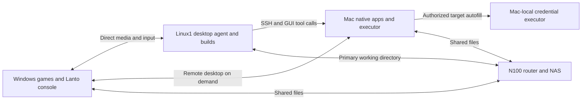

# Exploratory design notes

> This document records an early example workspace and possible future directions. Agent orchestration, NAS integration, and prewarmed multi-session switching are not implemented release features. See the [README](../README.md) for the current product scope.

Design date: 2026-10-16. Status: pairing, authorization, and status reporting between the controller and windowless Host are implemented; real streaming and switching between multiple machines await device validation.

Lanto provides one keyboard and mouse entry point for local Windows games, everyday development on Linux1, and native Mac applications. The user views remote desktops from Windows, the agent remains on Linux1, and N100 handles routing and storage. Media connections and tool execution are managed separately so background development tasks continue when the user switches views.

## Device responsibilities

| Device | Responsibilities | Local state to retain |
| --- | --- | --- |
| Main Windows PC | Games, Lanto console, remote desktop decoding, keyboard and mouse entry point | Windows, games, client configuration, and a small cache |
| Linux1 custom PC | Linux desktop, agent, computer use, IDE, browser, compilation and tests, optional Windows VM | OS, applications, build caches, container images, browser and agent runtime state |
| Mac | Native macOS applications, Xcode, signing, GUI tool executor | macOS, toolchain, GUI Bridge, signing materials, and runtime caches |
| N100 | Software router, DHCP/DNS, NAS primary working directories and shared files | Routing configuration, storage services, and persistent project files |
| Remaining custom PC | Future remote target, testing, or backup | Unassigned; do not reinstall in advance |

N100 has 8 GB RAM and six 2.5G network ports. Its NAS disk interfaces, bays, power, and cooling, and the other machines' network adapters and GPUs have not yet been inventoried. This design does not place large builds, desktop encoding, or agent inference on N100 by default.

## User flow

1. The user plays a local Windows game while the Linux1 agent works in a persistent session.
2. The user triggers the device-switch shortcut. Lanto shows Linux1's existing desktop and gives that session input ownership.
3. The user reviews agent results, edits the project, runs tests, and opens browser previews. Files are saved directly in the NAS primary working directory.
4. When the agent needs the Mac, it runs commands over SSH or calls Mac-local GUI tools, requesting configured credential autofill when necessary.
5. The user switches back to Windows. All remote keys and mouse capture are released while Linux1 tasks continue.

The first version uses a complete desktop as its main entry point. VS Code Remote SSH can supplement it on low-bandwidth connections, but does not replace the Linux1 desktop and computer-use workflow the user selected.

## Connection structure

Arrows represent logical communication, not media transcoding through N100. On the same LAN, the target host sends video directly to Windows. N100 provides routing and addressing; the forwarding path within the switched network depends on actual wiring. Software bridges across separate network ports also consume N100 resources: six ports are not automatically a hardware switch with no overhead.

## Client and media adapters

The console uses Electron, React, and TypeScript, built with electron-vite. Node.js handles local configuration, IPC, and process orchestration. Rust or platform helpers can be introduced when native capabilities are needed. Media adapters manage separate processes, initially reusing Moonlight Qt, with RDP or other protocols added after measurement. See [client architecture](architecture.md) for modules and current implementation boundaries.

The initial media view is a separate native window; the console manages activation, display mode, and returning locally. The WebView does not decode native Moonlight video. Embedding an external window can introduce DPI, focus, rendering, and lifecycle problems and requires a separate experiment before adoption.

The table describes target capabilities and lifecycle operations for future adapters. The current implementation covers starting and stopping one process and checking ports. Pairing uses the external Moonlight window; complete input leases and media telemetry are not yet implemented.

| Operation | Meaning |
| --- | --- |
| `probe` | Read host reachability, protocol version, capture/encoding capabilities, and input capabilities |
| `pair` | Establish device trust and save a certificate or host identity reference |
| `connect` | Create a media process with a distinct session ID |
| `activate` | Show the target window and acquire input ownership |
| `deactivate` | Release held keys and mouse/controller capture; disable inactive audio |
| `disconnect` | End the media session without ending remote agent or desktop tasks by default |
| `health` | Report connection, decoding, dropped frames, focus, and errors |

Moonlight already offers CLI options for resolution, fps, bitrate, window mode, absolute mouse, and system keys. Their existence does not prove that frame rate can change dynamically without cost or that all state can be safely shared between processes. [CLI source](https://github.com/moonlight-stream/moonlight-qt/blob/b0af84ead19e711a55db46f8900182d2e0fa3716/app/cli/commandlineparser.cpp).

## Sessions and input handover

Device connection states are `offline → discovered → pairing → ready → connecting → streaming`, with failures entering `reconnecting` or `failed`. Connection state and input ownership are separate: a session can stay connected without owning any input.

Switching always follows this sequence:

1. Stop sending new input to the old target and release remote keys and mouse buttons.
2. Revoke the old session's input lease and disable controller and inactive audio forwarding.
3. Activate the new target window and confirm focus; return to local Windows if this fails.
4. Grant input ownership to the new session and discard queued events carrying the old session ID.

Keep one reserved switch shortcut: Ctrl plus backtick (the key above Tab). Windows registers it locally; the native player recognizes the same binding while it captures system keys. Default locked mode hides the remote window locally, confines the mouse remotely, and forwards ordinary system shortcuts to the selected target. It disables Moonlight’s built-in shortcut combinations. Switching preserves the stream; device switches and application shutdown still disconnect. The optional free window mode restores normal desktop focus behavior. Protected OS shortcuts, elevated applications, and exclusive fullscreen need separate physical validation.

When streaming already carries keyboard and mouse input, Deskflow/Lan Mouse must not inject the same input again. A future custom input backend will use the same lease management.

Human takeover has priority when an agent and a person share a remote desktop. Pause that device's GUI automation scheduling until the user releases control; ordinary CLI builds can continue. This governs input and tool calls connected to Lanto and cannot automatically constrain unrelated external remote-control software.

## Linux1 desktop and persistent tasks

The desktop the user sees must be the same graphical session used by the agent's browser and GUI tools. An xrdp, container, or headless desktop is not the same session merely because it has the same hostname.

First record the Linux distribution, desktop environment, X11/Wayland session, GPU, and driver. Choose Sunshine capture and input permissions from this inventory. Selkies remains a conditional browser route: compare it with an existing X.Org session, or place all GUI work in its own Wayland session; do not assume it captures an existing Wayland session. [Selkies native deployment](https://docs.selkies.io/latest/native/).

Terminal agents can run in tmux or an appropriate service. Hiding the media window, disconnecting, or exiting the client should not actively terminate them. Host restarts and process crashes are separate recovery problems: a persistent remote desktop does not provide task recovery across restarts. [tmux introduction](https://github.com/tmux/tmux/wiki/Getting-Started).

## NAS primary working directory

Source working directories live on the N100 NAS and are mounted by Linux1, for example at `/mnt/nas/projects/app`. Compilation and tests still run on Linux1, with file access across the LAN. This provides one working directory without manual synchronization, but does not provide local-SSD access latency.

| Data | Default location | Reason |
| --- | --- | --- |
| Source, Git metadata, documents, assets | NAS | One persistent primary working directory |
| Release outputs and archived task logs | NAS | Access and backup from multiple devices |
| Dependencies, virtual environments, Rust target, Godot import caches, temporary outputs | Linux1 local caches, configured per project | Reduce small-file network operations; caches can be rebuilt |
| Docker image layers, browser profiles, agent session databases | Linux1 persistent local runtime directories | Meet storage-driver and database-locking requirements; do not treat all of these as disposable |
| Windows VM images and Windows-specific build caches | Prefer Linux1 local SSD | Avoid adding VM random I/O to the NAS working directory |
| SSH, signing, and password stores | Appropriate credential manager or machine-local secure storage | NAS and source repositories hold credential references only |

When source is mounted into a development container over the network, directories such as `node_modules` can be overlaid with local Linux1 volumes. Use separate dependencies and caches for different OSes and build targets; Windows and Linux must not share writes to one installation directory.

Prefer SMB for Windows/Mac shared files; Linux1 can initially use SMB too. Evaluate NFS for projects requiring POSIX permissions or symbolic links. Do not casually mix protocols or multiple writers for the same working directory. Concentrate everyday Git and build operations on Linux1, with separate worktrees for different agent tasks. Before starting a task, check the NAS mount and target directory identity to avoid writing into an empty local directory with the same name after a mount failure.

Node file watching on NFS/SMB can be unreliable, so configure polling per tool where needed. File databases such as SQLite cannot assume network locks behave like local locks. [Node file watching](https://nodejs.org/download/release/latest-jod/docs/api/fs.html), [SQLite over networks](https://www.sqlite.org/useovernet.html), [Docker storage requirements](https://docs.docker.com/engine/storage/drivers/select-storage-driver/).

## Mac executor and credentials

Prefer SSH for commands and builds; use a Mac-local Peekaboo Bridge or a verified executor for native applications. Linux1 calls an authenticated tool bridge without copying the model to the Mac. Tools return the target application, window or interface-snapshot identity, and operation result so later clicks and text entry stay bound to the same target.

Initial Mac setup requires Remote Login, a graphical session, Screen Recording, and Accessibility permissions. Capture requested over SSH must reach the correct GUI Bridge; checking only the CLI process's permission is insufficient. [Apple Remote Login](https://support.apple.com/en-au/guide/mac-help/mchlp1066/mac), [Peekaboo Bridge and permissions](https://peekaboo.sh/quickstart.html).

the local credential manager retains the existing credential-tool contract. Validate Linux-side SSH/HTTP credential use separately from Mac-side field autofill. Bind every autofill operation to a device, application or website, window, field, and one-time request ID. Autofill on the foreground Linux desktop is not Mac-local autofill. Client configuration and logs do not store password contents. Preserve explicit handling for Touch ID, MFA, signing keychains, and startup unlocking.

An earlier remote-build prototype provides source snapshots, SSH workers, reconnectable builds, logs, and cancellation, and can inform the build adapter. It was not changed in this round, and its snapshot model is not imposed on everyday NAS source editing.

## Windows builds

Linux1 remains the development entry point. Run JS/TS builds, suitable Rust Windows GNU targets, ordinary Godot Windows exports, and supported Electron packaging directly where possible. Use a Windows VM on Linux1 for Windows PyInstaller packages, MSVC, and native Node dependencies compiled on the target platform.

The agent prepares a separate build snapshot or working directory for the Windows VM and automatically collects outputs onto the NAS. Snapshots can include saved but uncommitted changes. Different toolchains must not share writes to dependencies and caches in the primary working directory. Data transfer still has a cost, but the user need not maintain a second everyday repository manually.

Final graphics, drivers, keyboard/mouse capture, and game performance require real Windows hardware acceptance. Building in a VM does not establish complete hardware equivalence. [Rust Windows targets](https://doc.rust-lang.org/rustc/platform-support/windows-gnu.html), [Electron cross-platform builds](https://www.electron.build/v26/docs/features/multi-platform-build/), [PyInstaller](https://pyinstaller.org/en/stable/), [Godot Windows export](https://docs.godotengine.org/en/stable/tutorials/export/exporting_for_windows.html).

## Network and device identity

Devices share a LAN. N100 uses DHCP reservations for regular devices; stable IP addresses help discovery but do not replace authentication. Lanto Host implements UUIDs, TLS certificates, one-time pairing credentials, and mDNS announcements. The controller stores trusted certificates and encrypted tokens. When multicast is unavailable, full pairing credentials locate the device. This management authorization is separate from Sunshine/Moonlight streaming pairing; see [Host documentation](host.md).

Media travels directly between Windows and the target host, without NAS, cloud, or proxy relaying by default. Achieving 2.5G shared-drive throughput also requires compatible client adapters, switching equipment, and NAS interfaces. Test bandwidth contention while shared-file transfers and desktop streaming run together; LAN speed is not the same as the internet subscription speed.

## Validation stages

### Stage zero: one Linux1 connection

- Inventory the Windows GPU and monitors, Linux GPU/desktop environment, and actual wired connection.
- Choose a stable Sunshine release and Moonlight client with a rollback path; record versions, configuration, and file checksums.
- Validate code reading, scrolling, dragging, terminals, Chinese input, and audio at 2560×1440 and 30fps.
- Confirm the user and agent share one graphical session and agent tasks continue after returning to a game or disconnecting.
- Repeatedly return locally and check that Ctrl/Alt/Shift, mouse buttons, and controllers retain no capture or pressed state.

### Stage one: two hosts and hot switching

- Evaluate one worker process per host with Linux1 and Mac connected simultaneously.
- Check for configuration or certificate-store overwrites, and validate focus changes, DPI, input release, and client exit.
- Compare CPU, GPU, VRAM, bandwidth, and game frame times for one active stream versus one active plus one prewarmed stream.
- Retain native window management first, then decide whether Moonlight changes or shared rendering surfaces are justified.

### Stage two: Mac execution

- Validate SSH commands, GUI screenshots, accessibility targeting, clicks, and ordinary text entry.
- Have the Mac credential executor autofill a test account and verify secrets appear in neither results nor ordinary logs.
- Verify human takeover pauses the GUI agent and resuming cannot execute stale coordinates or field operations.
- Separately validate screen locking, restarting, permission loss, and authentication requiring user participation.

### Stage three: NAS development and builds

- Measure Git, dependency installation, builds, and hot reload with real Rust, Electron/JS/TS, Python, and Godot projects.
- Compare NAS dependencies against local caches while keeping source on the NAS.
- Check disconnections, remounts, multiple worktrees, and collecting Windows VM build outputs.
- Connect the complete device inventory and task status before considering browser fallback views, RDP, and other devices.

## Performance records and initial acceptance targets

The initial display requirement was 2K at 30fps. It was revised on 2026-10-17 to selectable 4K, 30fps, and a higher bitrate for desktop text clarity. The time thresholds below are candidate engineering targets for stage zero, not measured results or hardware guarantees. If the baseline falls short, identify the bottleneck before adjusting the target or implementation.

| Metric | Candidate target or measurement |
| --- | --- |
| Resolution and frame rate | Up to 3840×2160; new profiles use 30fps, with 15/30/60fps selectable. Encoders may emit frames on demand for a static desktop. |
| Continuous active desktop use | Record presented frame rate, dropped frames, and stutter during scrolling; run for at least 30 minutes |
| Switching connected sessions | From key event to usable new view; initial P95 target ≤500ms over at least 100 switches |
| Input-to-video response | Initial P95 target ≤120ms; use external recording or consistent end-to-end measurement, not ping |
| Cold connection and reconnection | Record first frame, reauthentication, and restored input separately from hot-switch measurements |
| Bitrate | Start new 4K60 profiles at 120 Mbps per stream; expose 5–150 Mbps and verify text clarity and aggregate network headroom for up to two streams. |
| Background prewarming cost | Record CPU/GPU/VRAM and network use; do not promise zero overhead when hidden |
| Game impact | Compare frame times and input with Lanto closed, the console resident, and a prewarmed stream resident |
| Residual input | Repeated switching and abnormal disconnects must leave no held input; this is a functional pass criterion |

A 30fps frame interval is about 33.3ms. End-to-end response also includes input, capture, encoding, transport, decoding, and display. Smooth 30fps is not zero latency. Start with widely supported H.264 hardware encoding; treat HEVC, AV1, and 4:4:4 as per-device capabilities rather than universal guarantees.

## Information still needed

Linux1 CPU, memory, GPU, distribution, and desktop session; Mac chip and OS version; Windows decoder capabilities and monitors; N100 disk interfaces, drive types, cooling, and router OS; and the actual switched network. These determine capture backends, prewarmed-session count, NAS configuration, and final acceptance thresholds.

Missing information does not prevent documentation or a minimal prototype, but no target latency, unattended cross-platform operation, or Mac credential autofill is claimed before validation.
