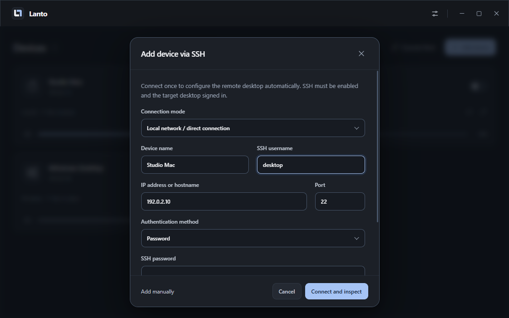
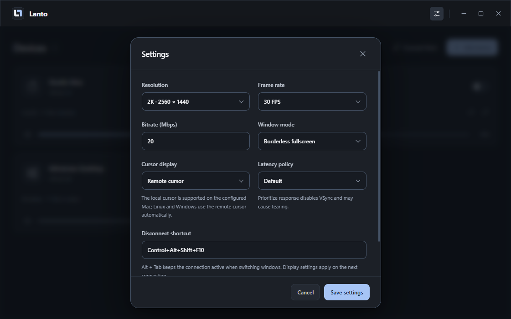

# Getting started

## What you need

- A Windows x64 controller. The release hardware checks used Windows 11.
- A Windows, macOS, or Linux target with a working graphical desktop and Sunshine-compatible capture/encoding.
- SSH and SFTP access from the controller to the target. Windows setup needs an administrator SSH account; macOS/Linux setup uses the desktop account and sudo where necessary.
- Internet access for missing target components during initial setup. Normal LAN use does not require a Lanto cloud account.

Fresh Linux provisioning supports the Ubuntu versions listed in the [SSH deployment guide](ssh-deployment.md). Other distributions can reuse an installed Sunshine server. Do not assume every GPU, compositor, ARM device, or headless configuration has been tested.

## Install the controller

Download the Windows ZIP and `SHA256SUMS.txt` from the same [release](https://github.com/omaekumiko3-dev/Lanto/releases/latest). Compare the ZIP's SHA-256:

```powershell
Get-FileHash .\Lanto-0.3.1-win-x64.zip -Algorithm SHA256
```

Extract the whole ZIP to a writable folder and open `Lanto.exe`. The application is portable but its preferences and pairing state live in the operating-system user-data directory, outside the extracted folder. The release executable is unsigned; only run a download whose source and checksum you trust.

## Add a computer

1. Enable SSH on the target and sign in to its graphical desktop.
2. In Lanto, select **Add device**. Choose **Local network / direct connection** for ordinary LAN use.
3. Enter a device name, target address, SSH user, and your chosen authentication method. Addresses in our screenshots are documentation examples, not real servers.
4. Select **Connect and inspect**. Compare the displayed SSH fingerprint with the target's fingerprint through a trusted channel.
5. Review the detected system and component reuse plan, then choose **Deploy**.
6. Complete any permission prompts on the target. Resume verification when requested.
7. Select **Connect device**.



The wizard preserves existing supported Host identities and Sunshine settings and reuses installed components when possible. SSH passwords and key passphrases are used for the current setup session; they are not written into the saved device entry.

Already have a Lanto Host? **Connect Host** provides discovery and ticket pairing. A manually configured Moonlight device can stream without a paired Lanto Host, but Host-dependent clipboard and file sharing will not be available.

## Permissions by platform

| Target | Check |
| --- | --- |
| macOS | Grant Screen Recording, Accessibility, and applicable audio/local-network permissions to the installed application. A permission prompt may require a local desktop interaction. |
| Windows | Keep the target desktop signed in. Host runs as LOCAL SERVICE; an interactive login task supplies desktop clipboard access. |
| Linux | Check capture support and the graphical user's session. Clipboard uses Python 3, GTK 3, and X11/Xwayland; a pure Wayland data-control backend is not included. |

The release includes a universal macOS clipboard helper. Source builds that omit it can compile the Swift helper on the target using Xcode Command Line Tools.

## Everyday use

Use the switch on a device card to connect or disconnect that device. Up to two streams can stay open. On the Windows controller, **Ctrl + `** (the default; custom bindings such as Alt plus backtick remain saved) cycles Local → remote 1 → remote 2 → Local, in connection order. With one device, the cycle is Local → remote → Local. Hold the modifier and tap the key repeatedly to advance once per press; keyboard autorepeat does not advance the cycle. Connecting a third device requires disconnecting one first.

**Switch only with shortcut** is enabled by default on Windows and requires the current bundled player. Local mode hides the remote window from clicks and task switching. Remote mode confines the mouse to the video and sends Alt+Tab, the Windows key, and other ordinary shortcuts to the target. The switch shortcut is reserved for Lanto in both modes. Disabling the setting restores free window interaction and the card’s **Show** button. Existing custom bindings stay saved; the former minimization option is replaced by this setting. Disconnect with the device card switch or by closing Lanto. Windows secure-desktop combinations such as Ctrl+Alt+Delete remain controlled by the local OS.

Adjust each card's volume or mute independently. These settings change playback on your controller, not the target's system volume.

In Settings, choose resolution, frame rate, bitrate, and window mode independently. New profiles start at **4K (3840 × 2160), 60 FPS, and 120 Mbps per stream**. Existing profiles keep their saved choices; select the new values and reconnect to apply them. 1440p and 1080p remain available, with 15/30/60 FPS and a manually adjustable 5–150 Mbps bitrate. Two streams at 120 Mbps need about 240 Mbps plus transport overhead, along with suitable capture and decoding hardware.

For sharper desktop text, match the stream resolution to your controller display and check the target's desktop resolution. Lanto does not automatically resize the target desktop. See [host display setup](host-display.md) for a true 4K source on headless Macs and Windows hosts with lower-resolution monitors. A higher bitrate preserves more image detail but needs more network bandwidth; lower it if your connection cannot sustain it. Performance data is optional. Experimental options require compatible native components; see [native notes](../native/README.md).



## Clipboard and files

Enable **Shared clipboard** for newly copied plain text and images. Open its arrow menu to enable **Share files**. Sharing covers all paired online Hosts, including when no desktop stream is open. Enable it only for trusted computers.

For files or folders: copy, wait for **Ready to paste**, then paste in the destination file manager. Do not paste while transfer is incomplete. Received files stay in a cache until you remove them. See [clipboard behavior](clipboard-sync.md) for formats, limits, cancellation, storage, and troubleshooting.

## Direct tunnel

Choose **Encrypted direct tunnel** when you have a reachable endpoint. Provisioning needs SSH first; subsequent transport uses UDP 48200 by default. Public IPv6 or IPv4 port forwarding can provide reachability. Lanto has no relay and does not guarantee a connection through restrictive NAT. Follow [the tunnel guide](direct-tunnel.md) rather than exposing arbitrary services to the internet.

## Troubleshooting

| Symptom | Start here |
| --- | --- |
| SSH inspection fails | Confirm the address, SSH/SFTP service, account, authentication method, and network route. |
| Fingerprint changed | Verify the new fingerprint independently before trusting it. |
| Host is reachable but desktop fails | Check Sunshine, media pairing, graphical login, capture permissions, GPU support, and firewall rules. Host reachability alone does not prove streaming. |
| Picture works but input/audio does not | Recheck target OS permissions and Sunshine configuration. |
| Clipboard is unavailable on Linux | Sign in to the graphical desktop, install required GTK/Xwayland dependencies, and use the latest Host runtime. |
| File transfer stopped | Check free disk space and connectivity, then copy again. Interrupted transfers are not resumable. |
| Tunnel fails | Confirm SSH setup completed and that the chosen UDP endpoint is reachable. LAN success does not establish internet reachability. |
| Switch shortcut fails | Choose an unused combination in Settings; another application may own the shortcut. |

For more help, open an [issue](https://github.com/omaekumiko3-dev/Lanto/issues) with the release version, platforms, steps, and redacted logs.

## Update or remove

Disconnect and quit Lanto before replacing its extracted application folder with a newer release. Keep the user-data directory to retain preferences and pairings. Updating the controller does not by itself replace every existing Host runtime; follow the release notes and [Host guide](host.md) when a Host update is required.

To remove the controller, quit it and delete its extracted folder. Separately remove its user data if you also want to remove saved configuration and local pairing state. Revoke the controller on each Host when retiring access. Remote Host/Sunshine services and received-file caches are separate installations; removing the local controller does not uninstall them.
